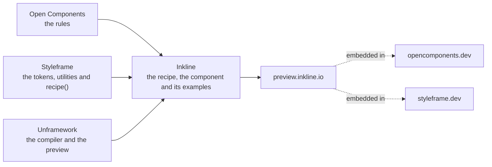

# Vision

UXFront makes the pieces you need to build an interface once and ship it everywhere: what a component must do, the compiler that takes it to every framework, the styles that give it its look and a library of components that put all three together. Each piece is its own project, with its own site and repository, so you can use one without the others.

Building it in pieces has a cost, and you've probably paid it before. Think of a button page that says one thing about focus while the button's styles say another, an example copied into three sites that's fixed in only one of them, or a component rewritten for every framework, a little differently each time. This page says how the five projects fit together, so that each one does its own part and the rest stays in one place.

We'll look at:

- **The layers:** what each project is for, and the question it answers.
- **How a component is made:** the order a component travels through the layers.
- **How the docs connect:** what each site keeps, what it links to and what it embeds.
- **Working by it:** the rules that follow, for anyone who works on these projects.
- **Where we are today:** how much of this already holds, and what's still on its way.

## At a glance

| Project         | Role             | Answers                                                          | Site                                             | Repository                                                                      |
| --------------- | ---------------- | ---------------------------------------------------------------- | ------------------------------------------------ | ------------------------------------------------------------------------------- |
| UXFront         | The organisation | How do the projects fit together, and what do they share?        | [uxfront.com](https://uxfront.com)               | [`uxfront-com`](https://github.com/uxfront-com)                                 |
| Open Components | The standard     | What must a component do, and why?                               | [opencomponents.dev](https://opencomponents.dev) | [`uxfront-com/open-components`](https://github.com/uxfront-com/open-components) |
| Unframework     | The compiler     | How does one component work in every framework?                  | [unframework.dev](https://unframework.dev)       | [`uxfront-com/unframework`](https://github.com/uxfront-com/unframework)         |
| Styleframe      | The styles       | How does a component look, and how do you change its look?       | [styleframe.dev](https://styleframe.dev)         | [`uxfront-com/styleframe`](https://github.com/uxfront-com/styleframe)           |
| Inkline         | The UI library   | Which components can you install today, and how do you use them? | [inkline.io](https://inkline.io)                 | [`uxfront-com/inkline`](https://github.com/uxfront-com/inkline)                 |

Each project answers its own question and links to the others for theirs. That one rule shapes everything below.

## The layers

Let's start with what each project is for. Read them from the top down: the standard comes first, and Inkline, at the bottom, builds on the three above it. This section describes each layer as we're building it, and [Where we are today](#where-we-are-today) says how far each one has got.

### UXFront

UXFront is the organisation the projects belong to. It owns the picture you're reading now, and the tools the projects share:

- **The site kit.** The `@uxfront/*` packages on npm, like `@uxfront/layer-docs` and `@uxfront/scene`, are what the Open Components, Unframework, Styleframe and Inkline sites are built on. Each site installs them from npm, so the sites look and work alike.
- **The shared configs.** `@uxfront/oxlint-config`, `@uxfront/oxfmt-config` and `@uxfront/typescript-config` keep the repositories' code in one style.
- **Testlane.** A CLI that turns any branch or pull request of a project into a workspace of its own that you can run.

UXFront defines no part of a component itself. That's the four projects' job.

### Open Components

Open Components is the standard: the guidelines a component meets for a good user experience, developer experience and agentic experience, whether a person or an AI agent writes it. We define every component here first, before it's styled or built, because the rules decide the rest. A button whose focus ring is styled before anyone agreed on how focus behaves gets styled twice.

A component's page holds its rules for each layer (UI, UX, DX and AX), a checklist of them with an id and a check for each, a contract that agents read, and the reasons behind it all, with sources. The [Button page](https://opencomponents.dev/docs/components/button) is the model for every page. The standard also names design tokens: the [Design Tokens](https://opencomponents.dev/docs/foundations/design-tokens) page says how a token path like `--color--primary` is built. Its MCP server and agent plugin hand the same rules to coding agents.

The standard stays apart from any one implementation, so it says what a component must do and leaves the code to the layers below.

### Unframework

Unframework is the compiler. You write a component once, as a `.uf.tsx` file, and it compiles to native React, Vue, Svelte, Angular, Solid, Qwik and Astro code, with no runtime of its own. That's how one component works in every framework without being rewritten for each one.

Unframework also runs your examples. `unframework preview` shows each example in every framework side by side, and `unframework preview build` writes the same preview as a static site you can deploy. Every example in that site has a URL of its own, `embed.html?example=<id>&target=<target>`, which any page can put in an `<iframe>`. That URL and the two messages it sends and takes, for its colour mode and its height, are [the embed contract](https://unframework.dev/docs/tooling/preview#embed-an-example), and Unframework's docs are where it's defined.

Unframework ships no design system and no styling engine of its own. It compiles whatever component you give it, so all compiler work happens here, never in a library that uses it.

### Styleframe

Styleframe is the styles layer. It gives you the means to style a design system, rather than a design system of its own: design tokens, themes, utilities, modifiers and `recipe()`, written in TypeScript and compiled to CSS. A **recipe** is a component's styles and the options that change them, like the Button's colours, variants and sizes, and `recipe()` is how you write one.

Anything that names a component belongs to Inkline, so the Button's recipe and every other component recipe belong in Inkline, in a theme package of its own, `@inkline/theme`. They still ship in `@styleframe/theme` today, and [Where we are today](#where-we-are-today) says how far their move has got.

A recipe follows the stylesheet rules of its component's standard, like styling each state from the attribute that exposes it. Behaviour, like keyboard handling, stays with the component.

### Inkline

Inkline is the UI library, and the layer where the others meet. Each Inkline component follows its Open Components standard, takes its look from a recipe written with Styleframe and is written once as a `.uf.tsx` file that Unframework compiles to every framework. It ships one package per framework, like `@inkline/react` and `@inkline/vue`, so you install only the one your app uses. The component recipes are Inkline's too, since they're the design system that Styleframe gives you the means to build.

Inkline is also the source of truth for examples and implementations. An example is written once, in Inkline, next to the component it shows, as `src/components/button/examples/ButtonVariants.example.uf.tsx` is. Inkline deploys its Unframework preview at [preview.inkline.io](https://preview.inkline.io), and that's where every other site's live examples come from.

## How a component is made

Now let's look at the order a component travels through the layers. Take a new component, like a Tabs:

1. **The standard.** Its Open Components page says what Tabs must do: the roles, the keyboard, the states and the checks for each rule.
2. **The styles.** Inkline writes the Tabs recipe with Styleframe's `recipe()`, following the stylesheet rules of its page, with tokens named as the standard names them. Anything the recipe needs that names no component, like a new utility or modifier, goes to Styleframe.
3. **The component.** Inkline writes Tabs once as a `.uf.tsx` file, styled with its recipe, and writes its examples beside it. Anything the compiler can't express yet goes to Unframework as a request, not into a workaround in Inkline.
4. **The compiler.** Unframework compiles Tabs and its examples to every framework, and Inkline publishes a package per framework.
5. **The docs.** Inkline's preview deploys the examples, and the Open Components and Styleframe pages embed them, so each site shows the component that's really shipped.



The solid arrows are what each layer builds on. The dotted ones are the only way the docs reach Inkline: through a URL in an `<iframe>`, never through a package.

## How the docs connect

Next, let's look at the docs. The Open Components, Styleframe and Inkline sites all document the same components, so they'd drift apart quickly if each kept its own copy of everything. Instead, each site keeps what its readers came for, links to the site that owns the rest and embeds the live example rather than copying it.

### What each site keeps

Here's what each site keeps, with the Button as the example:

| Site            | Its readers want to know                          | It keeps                                                                                                                                                         | It links to                                                                                  |
| --------------- | ------------------------------------------------- | ---------------------------------------------------------------------------------------------------------------------------------------------------------------- | -------------------------------------------------------------------------------------------- |
| Open Components | What a button must do, and why                    | The rules for each layer, the checklist, the contract, the anatomy, the reasons and the sources                                                                  | Inkline, as a library built to follow the standard                                           |
| Styleframe      | How to write the styles of a design system        | Tokens, themes, utilities and modifiers, and how to write a recipe with `recipe()`                                                                               | Inkline, for the component recipes, like the Button's                                        |
| Inkline         | How to use Inkline's button, and how it looks     | Installing it, its props, slots and events, its use in each framework, and the Button's recipe: its colours, variants and sizes, how to customise it and its API | Open Components, for the rules, and Styleframe, for the tokens, theming and how recipes work |
| Unframework     | How to write a component that compiles everywhere | The `.uf.tsx` language, the targets, the preview and the embed contract                                                                                          | Nothing on any one component: it documents the compiler, not a design system                 |

A fact lives on the site whose question it answers. Every other site that needs it says so in a sentence and links to it.

### What's worth repeating

Some things are worth saying on more than one site. We repeat these:

- **A one-sentence summary, with its link.** A reader of Inkline's Button recipe page should know that the recipe follows the Open Components Button's stylesheet rules, and that behaviour stays with the component. One sentence tells them, and the link takes them to the rules.
- **A fact that changes what this reader does.** If a recipe styles a state from an attribute, a reader building their own button needs to know they have to set that attribute. Say so on the recipe's page, in the recipe's terms.
- **The live example.** Each site shows the same Inkline example through its embed, which costs nothing to repeat: it's one source, so it can't drift.

And we don't repeat these:

- **Rules and checklists.** They belong to Open Components, and a copy elsewhere goes stale the day a rule changes.
- **Token and utility references.** They belong to Styleframe. Inkline's Theming page covers only what you need to theme Inkline, then sends you to Styleframe's docs for the rest.
- **The compiler's language and its options.** They belong to Unframework. Inkline's pages call it a separate product with its own docs, and nothing on them needs it.
- **An example's code, copied by hand.** Write it in Inkline and embed it.

When you're unsure, ask whether a link would lose the reader anything. If it wouldn't, link.

### Live examples

Every live example comes from Inkline's preview, so what you see on any site is the component Inkline ships, compiled by Unframework and styled by Styleframe. Open Components and Styleframe each embed an example by its id and the framework to show:

```html
<iframe
	src="https://preview.inkline.io/embed.html?example=src/components/button/examples/ButtonVariants&target=react&theme=light&resize=true"
	title="Button variants, in React"
></iframe>
```

The id is the example's path in Inkline's `ui/components` package without `.example.uf.tsx`, and `target` is one of Inkline's frameworks. The page frames it in its own colour mode and follows the frame's height. Each site keeps the preview's address in one constant, `INKLINE_PREVIEW_ORIGIN`, so moving the preview changes one line per site, and neither site depends on an Inkline package.

## Working by it

Finally, let's look at what this means for anyone who works on these projects, people and agents alike. These rules follow from the layers, and each comes with the reason it holds:

- **Start a component at its standard.** Write or update its Open Components page before the recipe or the component, since the rules decide what the other two must do.
- **Style it with Styleframe, in Inkline.** Write a component's look as its recipe in Inkline, with Styleframe's `recipe()`, since anything that names a component belongs to Inkline. Put what names no component, like a token, a utility or a modifier, in Styleframe, so any design system built on it can use it.
- **Write it once, in Inkline.** Change a component in its `.uf.tsx` file, never in a framework package, since every framework package is built from that one file.
- **Send compiler work to Unframework.** Inkline has retired its own compiler, since keeping two compilers in step cost more than it gave. When Inkline needs something the compiler can't do yet, it goes to Unframework.
- **Write each example once, in Inkline.** Other sites embed it. Since Inkline's preview deploys from `main`, an example lands in Inkline before another site embeds it.
- **Answer your page's question, and link for the rest.** Before you add a paragraph, check which project's question it answers. If it isn't yours, write one sentence and link.
- **Change a fact where it lives.** If a rule, a token or an example is wrong, fix it in the project that owns it, and the others follow.
- **Keep packages pointing up the stack.** Inkline depends on Styleframe and Unframework, and every site depends on the `@uxfront/*` kit. The docs reach Inkline only through the embed URL, so no site needs an Inkline release to update its pages.

## Where we are today

This is where we're going, and the Button has come the furthest. As of November 2026:

| Project         | Today                                                                                                                                                                                                                                                                                                                           |
| --------------- | ------------------------------------------------------------------------------------------------------------------------------------------------------------------------------------------------------------------------------------------------------------------------------------------------------------------------------- |
| Open Components | The Button's pages embed Inkline's examples. The other component pages show Open Components' own Vue 3 reference implementations, which every page also shows as code.                                                                                                                                                          |
| Unframework     | On npm as `@uxfront/unframework`, with the preview and the embed contract in `@unframework.dev/visual`. Its plan's design-system milestone, M10, takes Inkline's component families and the Open Components Button as its acceptance test.                                                                                      |
| Styleframe      | The component recipes still ship in `@styleframe/theme`, with their pages in Styleframe's docs, and they're moving to a new Inkline package, `@inkline/theme`. The Button page embeds Inkline's examples, and the other recipe pages show Styleframe's own Storybook. Some recipe pages link to their Open Components standard. |
| Inkline         | Unframework has compiled its component families and their examples since November 2026. The Button has been brought to its Open Components standard, and its docs cover the Button but show no live examples yet. The framework packages aren't on npm yet.                                                                     |

So for now, Styleframe has recipes for components the standard doesn't cover yet, and most components don't have an Inkline example to embed. As each component reaches the standard and Inkline, its pages move to the pattern this page sets out: rules on Open Components, the recipe, the component and its examples in Inkline, and Inkline's live examples on every site. Until then, Open Components' Vue 3 reference implementations and Styleframe's Storybook stand in on the pages that have no Inkline example.
